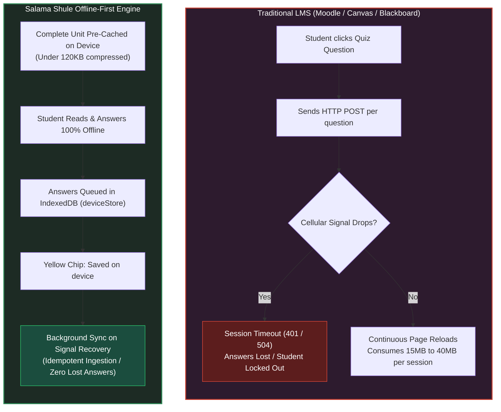
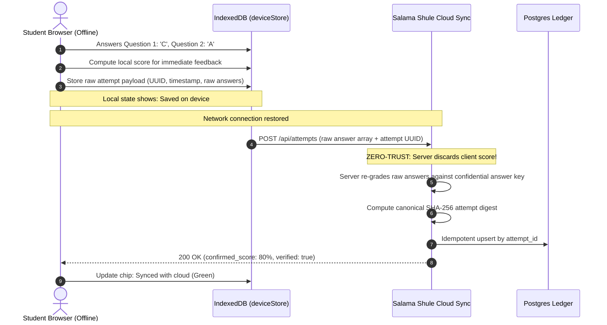

# Salama Shule: Technical & Architectural Knowledge Base

**Audience**: Non-technical team members, presenters, judges, educational officers, and school administrators.  
**Mission**: Explain why offline-first architecture is non-negotiable for Kenyan education and how Salama Shule delivers reliable digital learning with zero continuous connectivity.  
**Repository Wiki**: [GitHub Wiki Page](wiki)

---

## Navigation & Core Topics

```text
├── 1. The Incumbent LMS Myth (Moodle / Canvas vs Salama Shule)
├── 2. Kenyan Connectivity Realities (Edge Networks & Mobile Bundle Costs)
├── 3. Zero-Trust Assessment Architecture (Server-Side Re-Marking)
├── 4. Offline Queue & Resilient Ingestion Protocol
├── 5. Institutional Implementation & Teacher Operations (SMS / WhatsApp)
└── 6. Legal & Privacy Compliance (KDPA 2019 & Minimal Student Telemetry)
```

---

## 1. The Incumbent LMS Myth (Moodle / Canvas vs Salama Shule)

A common question during hackathon evaluations is:  
*"Universities and schools already use Moodle or Google Classroom. Why do we need Salama Shule?"*

Traditional Learning Management Systems (LMS) were designed for Western institutions with continuous, high-speed fiber internet and unlimited Wi-Fi. In the Kenyan classroom context, they fail predictably:



### Comparative Analysis: Moodle vs Salama Shule

| Metric | Traditional Moodle / Canvas | Salama Shule |
| :--- | :--- | :--- |
| **Connectivity Requirement** | Continuous 3G/4G/Wi-Fi connection | **100% Offline Capable** (only needs sync pulse) |
| **Data Cost Per Lesson** | 10MB to 50MB (uncompressed assets) | **< 150KB** (lightweight text + CSS) |
| **Network Failure Impact** | Immediate session loss & failed submission | **Zero data loss** (local queue in browser) |
| **Device Resource Footprint** | Heavy DOM, requires modern phone/laptop | Runs on **Android 8+ budget smartphones** |
| **Lecturer Sync Interface** | Manual CSV re-uploads | **Automatic idempotent sync & WhatsApp export** |

---

## 2. Kenyan Connectivity Realities (Edge Networks & Mobile Bundles)

In Kenya, mobile data penetration is high, but connectivity quality is erratic:
- **The "Edge" Problem**: Outside major metropolitan centers (Nairobi, Mombasa, Kisumu), connections drop from 4G to 2G/EDGE or suffer high packet loss during peak school hours.
- **The Mobile Data Bundle Economy**: Kenyan students frequently operate on daily micro-bundles (e.g. 50MB for KES 20). Loading a standard video LMS consumes the student's entire bundle in 3 minutes.
- **Intermittent Power**: Rural schools frequently experience grid instability. When school Wi-Fi or charging stations drop, student progress cannot depend on continuous server sessions.

Salama Shule treats offline as the **primary operating mode**, not an error state.

---

## 3. Zero-Trust Assessment Architecture (Server-Side Re-Marking)

A frequent security question from cynical judges is:  
*"If the student is offline, how do you prevent them from inspecting browser storage and faking a 100% score?"*

Salama Shule solves this using **Zero-Trust Client Telemetry**:



### The Security Invariant:
1. The student browser only holds question text and option indices during quiz execution.
2. Even if a technically adept student edits local JavaScript or storage to report `score: 100%`, **the server discards the client's score**.
3. The server independently re-marks every answer against the database answer key before persisting the record into the lecturer's gradebook.

---

## 4. Resilient Ingestion & Conflict Resolution

When multiple attempts sync simultaneously, Salama Shule guarantees data integrity through:
- **UUIDv4 Attempt Identifiers**: Each quiz attempt generates a globally unique identifier at quiz start.
- **Idempotent Ingestion**: If an unstable network retries a POST payload 3 times, Postgres catches the duplicate primary key and returns `200 OK` without creating duplicate records or altering timestamp history.
- **Chronological Audit Trail**: Every attempt logs `client_started_at`, `client_completed_at`, and `server_ingested_at`.

---

## 5. Lecturer Experience & Institutional Realities

Kenyan teachers and lecturers do not want complicated enterprise software. Salama Shule provides:
- **Classroom Code System (`SAFE-2026`)**: Zero barrier student onboarding without complex email verifications.
- **One-Click Offline Gradebook Export**: Teachers can download offline CSVs or generate instant WhatsApp-ready summary cards to share with parents and school administrators.
- **Low Hardware Threshold**: The lecturer portal operates smoothly on standard government-issued teacher laptops or tablets.

---

## 6. Privacy & Legal Compliance (KDPA 2019)

Under the **Kenya Data Protection Act 2019**:
- **Data Minimization**: Salama Shule collects only student name and registration identifier. Zero biometric data, zero GPS coordinates, and zero ad-tracking telemetry.
- **Local Sovereignty**: Student learning materials remain on the student's personal hardware without requiring persistent cloud surveillance.
- **Cryptographic Integrity**: All transmissions over the wire use TLS 1.3 with cryptographic SHA-256 payload checksums.
