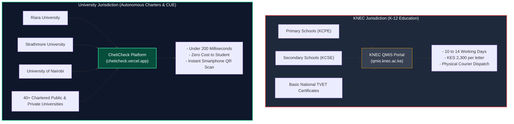
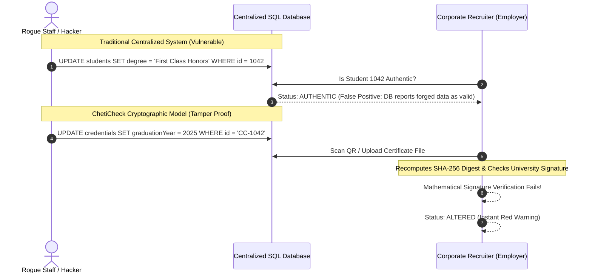
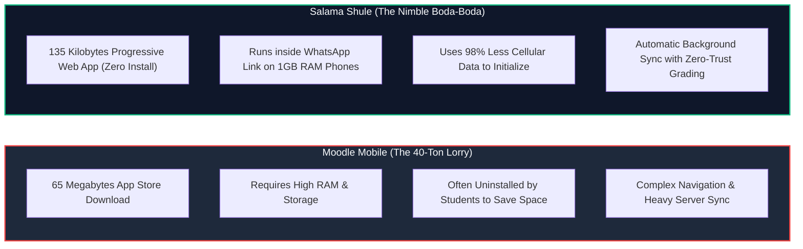
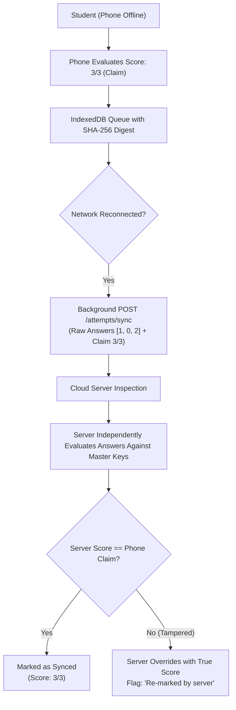
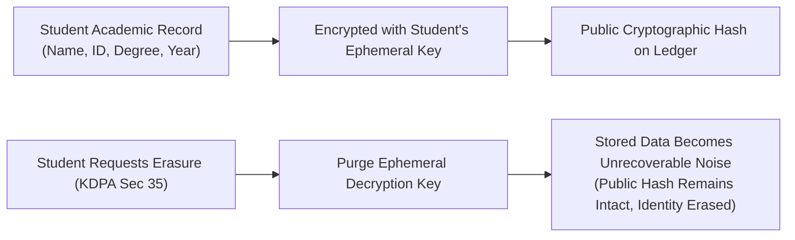

# Hackathon Knowledge Base & Visual Wiki

**Target Audience**: Non-technical team members, presenters, student founders, and hackathon judges.  
**Purpose**: An accessible, visual guide to the technical, legal, and operational reality behind **ChetiCheck** and **Salama Shule**.  
**Live Interactive Web Version**: [https://cheticheck.vercel.app/wiki.html](https://cheticheck.vercel.app/wiki.html)

---

## Executive Navigation & Quick Links

```text
├── 1. The Government Monopoly Myth (KNEC vs ChetiCheck)
├── 2. Centralized Database Honeypots vs Asymmetric Cryptography
├── 3. The Incumbent LMS Myth (Moodle/Canvas vs Salama Shule)
├── 4. Zero-Trust Client Scoring (Why the Bank Teller Counts Cash)
├── 5. Kenyan Institutional Realities (PPADA 2015 & University Procurement)
└── 6. Legal Compliance (KDPA 2019 & Cryptographic Shredding)
```

---

## 1. The Government Monopoly Myth (KNEC vs ChetiCheck)

A common assumption during hackathon evaluations is: *"The Kenyan Government already has a portal (KNEC) and a central database, so why do we need ChetiCheck?"*

This assumption confuses two completely separate regulatory bodies in Kenya:



### The Legal Reality:
- **KNEC has zero jurisdiction, zero database records, and zero mandate over university degrees or postgraduate diplomas.**
- University degrees in Kenya are legally autonomous under individual University Charters and regulated exclusively by the **Commission for University Education (CUE)**.
- If an employer approaches KNEC to verify a Bachelor of Science from Riara University, KNEC will turn them away.
- ChetiCheck solves the massive higher-education credential fraud market that KNEC does not touch.

### Comparison Table: KNEC QMIS vs ChetiCheck

| Feature | KNEC QMIS Portal (`qmis.knec.ac.ke`) | ChetiCheck Platform |
|---|---|---|
| **Target Sector** | Primary & Secondary (KCPE / KCSE) | **Higher Education Degrees, Diplomas, & Short Courses** |
| **Verification Speed** | **10 to 14 working days** (approx. 2 weeks) | **Under 200 milliseconds** (instant) |
| **Cost to Verify** | **KES 2,280 – KES 2,320** per letter | **Free for graduate**, KES 250 for corporate API pull |
| **Verification Method** | Manual staff search in physical/digital archives | Instant mathematical check against public key |
| **Delivery Mechanism** | Physical paper letter or courier dispatch | Real-time digital stamp on any smartphone camera |
| **Tamper Resistance** | Paper letter can still be scanned and altered in Photoshop | Cryptographic Ed25519 signature breaks if 1 byte changes |

---

## 2. Centralized Database Honeypots vs Asymmetric Cryptography

Why does ChetiCheck use **asymmetric Ed25519 digital signatures** instead of just hosting a normal database like traditional university systems?



### The Plain-English Mental Model:
- **The Centralized Database Approach**: Trust is placed in whoever currently controls the server. If a rogue database administrator takes a bribe or an SQL injection vulnerability occurs, the database happily tells employers that a forged degree is valid.
- **The ChetiCheck Cryptographic Approach**: Trust is placed in mathematical law. When the degree is issued, the university registrar seals it with the university's private signing key. Even if a hacker alters the database or photoshops a PDF, the mathematical signature does not match the altered data. The verification screen immediately flashes **Altered**.

---

## 3. The Incumbent LMS Myth (Moodle/Canvas vs Salama Shule)

Judges often ask: *"Riara and other universities already run Moodle or Canvas. Both have mobile apps. Why does Salama Shule exist?"*



### The Field Reality:
- In Kenya, entry-level smartphones (Tecno, Infinix, itel) typically have 16GB or 32GB of total storage, running Android Go.
- Students actively uninstall heavy 50MB+ applications because storage runs out.
- Salama Shule requires **zero installation from Google Play**. It launches directly from a lecturer's WhatsApp link, caches the lesson unit in IndexedDB under 135kB, and operates completely offline.

---

## 4. Zero-Trust Client Scoring: Why the Bank Teller Counts Cash

When a student finishes a quiz offline, why doesn't the backend just accept the score calculated on their phone?



### The Plain-English Mental Model:
When you go to an ATM or a bank teller, you can write "KES 50,000" on the deposit slip. The bank does not credit your account based on your handwriting; the teller feeds the physical banknotes into a counting machine. In Salama Shule:
- The score shown on the student's phone is strictly an **unverified claim** to encourage the student offline.
- Upon reconnection, the server independently counts the raw answers against the master answer key. If a student altered their browser storage to claim 100%, the server re-marks the quiz to their true score and flags the discrepancy on the Lecturer Dashboard.

---

## 5. Kenyan Institutional Realities (PPADA 2015 & Procurement)

### The 18-Month Procurement Obstacle:
Kenyan chartered private and public universities are bound by strict procurement protocols (under the Public Procurement and Asset Disposal Act - PPADA 2015). Selling an enterprise-wide LMS or credential system takes 12 to 18 months of tender notices, ICT committee vetting, Senate approvals, and budget allocations.

### ChetiCheck & Salama Shule Strategy: The Departmental Pilot
- **We do not sell enterprise infrastructure overhauls.**
- **Zero Cost to Faculty**: Lecturers and registrars adopt the platforms as a departmental teaching and continuous-assessment utility at zero setup cost.
- **Downstream Monetization**:
  - For ChetiCheck: Corporate recruiting agencies (BrighterMonday, Shortlist, corporate banks) pay **KES 250 per instant API query** to replace weeks of manual registry clearance calls.
  - For Salama Shule: Departmental continuous assessment modules operate friction-free without requiring university Senate tender approval.

---

## 6. Legal Compliance (KDPA 2019 & Cryptographic Shredding)

Under Section 35 of the **Kenya Data Protection Act 2019 (KDPA)**, individuals have a statutory **Right to Erasure** ("Right to be Forgotten"). How can ChetiCheck comply if cryptographic records are tamper-proof?



### The Plain-English Mental Model:
Imagine a lockbox where a graduate's name is inside, but only the graduate holds the key. If the graduate asks to be forgotten, you destroy the key. The lockbox is now permanently unreadable junk numbers, effectively erasing the identity forever without destroying the structural validity of the university registry. This is known as **Cryptographic Shredding**, fully compliant with Office of the Data Protection Commissioner (ODPC) guidelines.
