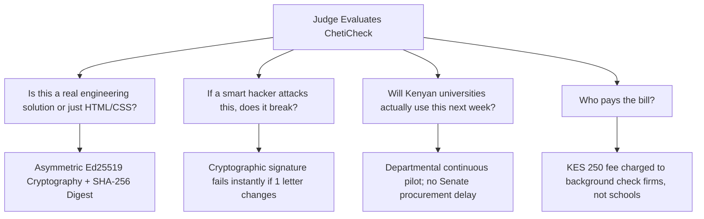
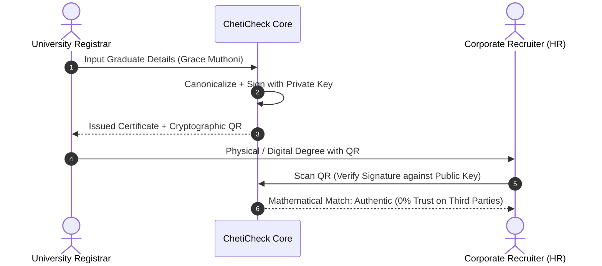

# ChetiCheck: Judge Attack & Defense Manual (Non-Technical Guide)

**Audience**: Presenters, student founders, and non-technical team members.  
**Purpose**: Prepare the team to answer tough, cynical, or aggressive questions from hackathon judges, technical investors, and university registrars with confidence.  
**Core Motto**: Never panic. Acknowledge the question, use the physical analogy, cite the Kenya context, and state the production roadmap.

---

## 1. How Hackathon Judges Think

Hackathon judges are usually senior software engineers, former startup founders, or corporate CTOs. They have seen hundreds of student pitches. They are inherently skeptical of:
- **Demo Mirages**: Buttons that only work because the data is hardcoded.
- **Buzzword Soup**: Pitching "AI" or "Blockchain" when simple math or standard databases work better.
- **Naive Economics**: Believing universities or students will gladly hand over money.

---

## 2. The 5 Major Judge Attacks & Word-for-Word Responses

---

### Attack 1: The "Rubber Stamp" Attack (Key Custody & Rogue Staff)

#### The Trap Question:
> *"If your signing keys are in the database, what stops a corrupt IT technician or registrar at Riara from secretly issuing 50 fake degrees for their friends?"*

#### The Plain-English Analogy:
Think of the university's physical embossing seal. In a poorly run office, the seal is left on a desk where anyone with office keys can stamp paper at night. In a secure bank, that seal is locked inside a dual-key safe that requires two senior directors to turn keys simultaneously. In our 48-hour prototype, the key is like having the seal on the desk (in the database) to demonstrate the math. In the real world, the seal is placed in a hardware vault.

#### What to Say Word-for-Word on Stage:
> "That is a critical security distinction. In this 48-hour hackathon build, we generated the Ed25519 keypair in software so judges can test issuance in real-time. In production, ChetiCheck connects to a FIPS 140-2 Level 3 Cloud Hardware Security Module (HSM). The university registrar never touches the raw private key; issuance requires multi-signature approval from both the Dean and Academic Registrar before the hardware module signs the digest."

---

### Attack 2: The "PDF File Upload" Attack (File Hash vs QR Data)

#### The Trap Question:
> *"If an employer uploads an actual PDF copy of the certificate, how can its hash match your JSON string hash? Every PDF generator produces different bytes!"*

#### The Plain-English Analogy:
If you take a photo of your National ID card with an iPhone and another photo with a Samsung, the image files are completely different sizes and pixel arrangements, but your ID number and name on the card are identical. ChetiCheck does not hash the random background pixels of the PDF; it hashes the official text data (Name, Degree, Year) encoded inside the QR code.

#### What to Say Word-for-Word on Stage:
> "We do not verify the raw binary PDF file wrapper, because PDF printer drivers inject different font headers and timestamps. Instead, ChetiCheck canonicalizes the W3C Verifiable Credential data payload embedded within the signed QR code. The employer verifies the mathematical digest of the academic record itself, rendering the verification immune to printer formatting quirks."

---

### Attack 3: The "Why Not a Simple Database?" Attack (The Crypto Trap)

#### The Trap Question:
> *"If the employer must visit your website to check if a degree was revoked, why do you need fancy asymmetric cryptography at all? Why not just use a simple SQL database lookup like universities already do?"*

#### The Plain-English Analogy:
Imagine an airline boarding pass with a digital barcode. The gate agent can scan your boarding pass even if their internet drops for 30 seconds, because the barcode has an airline digital signature that proves the airline issued it. A simple database lookup requires you to trust whoever is hosting the website right now. An Ed25519 signature is mathematical proof that cannot be faked even if the web server itself is hacked.

#### What to Say Word-for-Word on Stage:
> "A simple database lookup requires the verifier to trust the server hosting the API. If an attacker breaches the database or alters a table, the API happily returns fraudulent data as valid. With Ed25519 asymmetric signatures, trust is anchored in the university's mathematical key. Even if our server database is completely compromised, an attacker cannot forge the university's signature on a new degree."

---

### Attack 4: The "18-Month Procurement" Attack (Kenyan Bureaucracy)

#### The Trap Question:
> *"Kenyan universities take 12 to 18 months to approve software through procurement committees and Senate. You have no registered company. How does this survive past Sunday?"*

#### The Plain-English Analogy:
If you try to sell a new engine to an airline, it takes 3 years of safety committees. But if you give the pilots an iPad app that helps them check weather faster for free, they start using it tomorrow. We do not sell an expensive Enterprise ERP overhaul to the University Council; we offer a free departmental pilot to individual faculties.

#### What to Say Word-for-Word on Stage:
> "We are not selling a multi-million-shilling ERP replacement that requires a 12-month public procurement tender. ChetiCheck operates as a zero-cost issuance utility for the faculty registrar. The university pays zero setup fees. We monetize downstream: commercial recruiting platforms and background check agencies pay a small per-query fee to automate what currently takes 4 weeks of manual registry calls."

---

### Attack 5: The "Kenya Data Protection Act" Attack (ODPC Compliance)

#### The Trap Question:
> *"Under the Kenya Data Protection Act 2019, students have the right to request erasure of their personal data. If your audit log is an immutable hash chain, how do you delete a graduate's records without breaking the chain?"*

#### The Plain-English Analogy:
Imagine a secret lockbox where the lockbox has a student's name inside, but the key to open it is owned only by the student. If the student asks to be forgotten, you destroy the key. The lockbox is now permanently unreadable junk numbers, effectively erasing the identity without destroying the box structure.

#### What to Say Word-for-Word on Stage:
> "We comply with Section 35 of the KDPA through Cryptographic Shredding. In our production architecture, Personally Identifiable Information (PII) is encrypted with a distinct per-record secret. When a graduate exercises their statutory Right to Erasure, the encryption key is permanently discarded. The public signature digest remains intact to prevent registry forgery, but the underlying identity is rendered permanently un-linkable and anonymous."

---

### Attack 6: The "KNEC Already Does This" Attack (The Government Database Edge)

#### The Trap Question:
> *"Why would employers use ChetiCheck when KNEC already has a government verification portal with the official national database? Doesn't the government have an unassailable edge?"*

#### The Plain-English Analogy:
Think of the National Transport and Safety Authority (NTSA) vs a private car dealership. NTSA gives you a driving license, but NTSA has no record of your internal mechanical inspections or private service warranties. Similarly, KNEC is strictly for high school (KCSE/KCPE). KNEC does not issue or hold university degrees for Riara, Strathmore, or UoN. Furthermore, KNEC takes 14 business days and charges KES 2,300 for a paper letter. ChetiCheck is instant (200 milliseconds) on a mobile phone for zero shillings.

#### What to Say Word-for-Word on Stage:
> "That is a common misconception about Kenyan educational jurisdiction. KNEC only covers primary, secondary, and basic TVET exams (KCPE/KCSE). KNEC has zero mandate or database records for university degrees or diplomas; higher education is regulated by individual university charters and the Commission for University Education (CUE). Furthermore, KNEC's QMIS portal requires physical document uploads, charges KES 2,300 per verification letter, and takes 10 to 14 working days. ChetiCheck solves the unaddressed higher-education sector with sub-second, zero-cost QR cryptographic verification, while adhering to W3C Verifiable Credential standards that can directly feed into the Kenya National Qualifications Authority (KNQA) national framework."

---

## 3. Quick-Reference Stage Defense Cheat Sheet

Print this or keep it open on your phone backstage before walking up to pitch:

| Attack Vector | Focus Area | 5-Second Anchor Thought | Key Phrase to Deliver |
|---|---|---|---|
| **Key Theft** | Security | Private key locked in safe | "FIPS 140-2 Level 3 Cloud HSM with multi-signature sign-off." |
| **PDF Hash** | Verification | We check data, not pixels | "We verify the canonical W3C data payload in the QR code, not printer pixel variations." |
| **Crypto Redundancy** | Architecture | Boarding pass vs phone call | "Signatures provide zero-trust mathematical proof independent of server integrity." |
| **Bureaucracy** | Business | Free pilot for faculty | "Free departmental utility; revenue comes from employer background check APIs." |
| **Data Privacy** | Law (KDPA) | Destroy the key, not the ledger | "Complies via Cryptographic Shredding under ODPC guidelines." |
| **KNEC Monopoly** | Market Reality | High school vs University | "KNEC only handles KCSE/KCPE and takes 14 days at KES 2,300; ChetiCheck covers universities in 200ms." |
