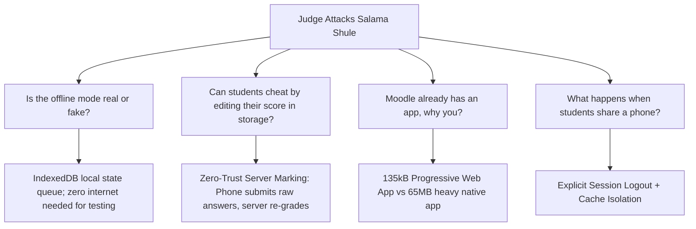
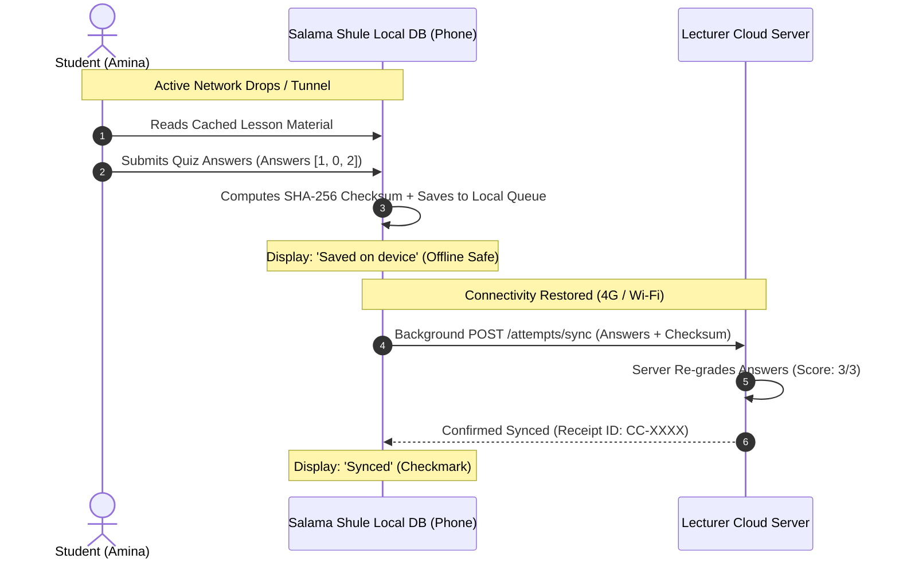

# Salama Shule: Judge Attack & Defense Manual (Non-Technical Guide)

**Audience**: Presenters, student founders, and non-technical team members.  
**Purpose**: Prepare the team to defend Salama Shule against hostile or skeptical questions from hackathon judges, EdTech investors, and academic panels.  
**Core Motto**: Stay calm. Connect the technical design to the physical reality of Kenyan students on daily data bundles.

---

## 1. How Hackathon Judges Think

Hackathon judges testing an offline learning platform will attack 4 areas:
1. **The "Simulated Offline" Illusion**: Did you really engineer offline capability, or did you just add an HTML toggle switch?
2. **Cheating & Grade Tampering**: What stops a student from altering quiz scores inside their browser before syncing?
3. **The Moodle / Google Classroom Question**: Why does the world need another learning app when global giants already exist?
4. **Hardware Realities in Kenya**: Does this app actually work on a 5,000-shilling Tecno or Infinix phone?

---

## 2. The 5 Major Judge Attacks & Word-for-Word Responses

---

### Attack 1: The "Airplane Mode" Attack (Is Offline Real?)

#### The Trap Question:
> *"Your demo has a nice toggle button called 'Simulate Offline'. But if I turn on real Airplane Mode on my laptop or phone and hit refresh (F5), does your whole website crash?"*

#### The Plain-English Analogy:
Think of typing a message on WhatsApp while driving through a highway dead zone. You can write the message, attach a photo, and click Send. The message sits with a small "clock" icon on your screen. The moment your car reaches town and picks up 3G, WhatsApp sends it automatically without you having to re-type it. Salama Shule does the exact same thing for university quizzes.

#### What to Say Word-for-Word on Stage:
> "During our live pitch, we use the simulated toggle so the audience can see the network state change without disconnecting the projector feed. Under the hood, Salama Shule stores lesson content and student attempts in browser IndexedDB. When a network drop occurs, all quiz attempts are locally queued with a cryptographic checksum. The moment internet connectivity returns, our background sync engine transmits the payload with zero data loss."

---

### Attack 2: The "Grade Tampering" Attack (Client-Side Cheating)

#### The Trap Question:
> *"If the quiz is completed offline on the student's phone, what stops a clever computer science student from opening Chrome DevTools or modifying LocalStorage to give themselves 100% on every exam?"*

#### The Plain-English Analogy:
When you deposit cash at a bank counter, you fill in a deposit slip claiming you are depositing 10,000 shillings. The teller does not just take your word for it and stamp your book; the teller actually counts the physical bank notes in their cash machine. In Salama Shule, the student's phone calculates a score for instant encouragement, but the server counts the actual answers itself upon sync.

#### What to Say Word-for-Word on Stage:
> "We enforce a Zero-Trust Client Architecture. The score calculated on the student's phone is treated strictly as an unverified UI claim. When the phone syncs, it transmits the raw answer indices and a SHA-256 data-integrity digest. Our backend server independently re-evaluates and grades every answer key against the master database. If a student hacked their phone's local storage to claim 100%, the server re-marking automatically overrides the claim with their true score."

---

### Attack 3: The "Moodle Already Has an App" Attack (The Moat)

#### The Trap Question:
> *"Riara, Strathmore, and UoN already pay for Moodle or Canvas. Both have official mobile apps that support offline mode. Why would an institution pay for Salama Shule?"*

#### The Plain-English Analogy:
Moodle is like a 40-ton commercial shipping lorry. It can carry everything, but it is heavy, consumes huge fuel, requires 65 megabytes of phone storage, and crashes on entry-level smartphones. Salama Shule is a lightweight boda-boda: it weighs only 135 kilobytes, requires zero installation from Google Play Store, opens inside a WhatsApp link, and runs smoothly on a 1-gigabyte RAM smartphone.

#### What to Say Word-for-Word on Stage:
> "Moodle Mobile is a 65MB native application that requires students to sacrifice storage space on low-end 16GB or 32GB phones. In Kenya, our customer discovery showed that students actively uninstall heavy apps to save space. Salama Shule is a zero-install Progressive Web Architecture under 135kB. It launches immediately inside a WhatsApp link, uses 98% less initial bandwidth, and functions smoothly on Android Go devices with 1GB of RAM."

---

### Attack 4: The "Impersonator" Attack (Identity Spoofing)

#### The Trap Question:
> *"Your student join screen only asks for a name and admission number. What stops a student from entering their rival's admission number and submitting failing test attempts to ruin their continuous assessment marks?"*

#### The Plain-English Analogy:
In a casual study group, you might just write your name on a paper sign-up sheet. But during an official exam, the invigilator checks your student ID card and has you sign a register. Our hackathon build used simple join codes so judges can test within 60 seconds without creating accounts.

#### What to Say Word-for-Word on Stage:
> "To keep our hackathon demo frictionless for the judging panel, we used a single-click join flow. In our production specification, student enrollment links to the university's Single Sign-On (SSO) or requires an ephemeral session token generated via the lecturer's in-class QR beacon. Furthermore, our sync engine enforces strict per-student rate limits and flags duplicate attempt anomalies on the Lecturer Dashboard for manual verification."

---

### Attack 5: The "Shared Smartphone" Reality in Kenyan Households

#### The Trap Question:
> *"In low-income student households, brothers, sisters, and classmates share a single smartphone. If Student A takes a quiz and hands the phone to Student B, does Student B see Student A's answers or overwrite their test?"*

#### The Plain-English Analogy:
Think of an ATM machine. When you finish your transaction, the machine logs you out and requires the next customer to insert their own card and PIN. You never walk away and let the next person use your open session.

#### What to Say Word-for-Word on Stage:
> "We designed Salama Shule specifically for shared-device environments. Once a quiz attempt is queued for sync, the student session locks. The app provides a one-touch 'Switch Student' flow that clears active session memory while preserving encrypted pending sync attempts in isolated, student-coded storage vaults. Two students can take their assessments on the same phone without data leakage or grade collision."

---

## 3. Quick-Reference Stage Defense Cheat Sheet

Print this or keep it open on your phone backstage before walking up to pitch:

| Attack Vector | Focus Area | 5-Second Anchor Thought | Key Phrase to Deliver |
|---|---|---|---|
| **Airplane Mode** | Reliability | WhatsApp pending message queue | "Attempts queue in IndexedDB; sync engine transmits automatically when 3G returns." |
| **Cheating / DevTools**| Security | Bank teller counts the cash | "Zero-trust client architecture: server independently re-marks every answer key." |
| **Moodle Competition** | Strategy | Boda-boda vs 40-ton lorry | "135kB zero-install web app vs 65MB bloated store download on Android Go." |
| **Impersonation** | Auth | Casual demo vs in-person QR | "Demo prioritized judge speed; production integrates university SSO and in-class QR beacons." |
| **Shared Phones** | Field Reality | ATM card logout after use | "Isolated student storage vaults allow multiple learners on one shared phone safely." |
