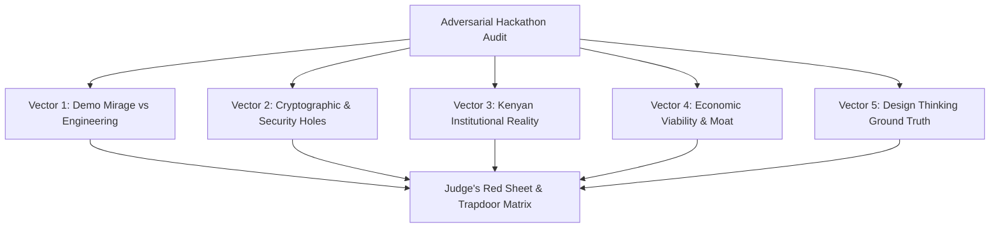

# Plan: Ruthless Hackathon Judge Audit & Vulnerability Assessment

## Goal Description
Conduct an adversarial, pessimistic hackathon audit on both **ChetiCheck** and **Salama Shule** from the perspective of an elite Silicon Savannah hackathon judge / technical investor. The audit targets load-bearing technical, operational, and commercial assumptions to expose all weak points, indefensible claims, and trapdoor questions before pitch day.

---

## 1. Agent Architecture & Mode Verification
- **Audit Agent 31 (`hackathon-judge-agent`)**: Verify configuration and role parameters in `C:\Users\user pc\agents\31-hackathon-judge-agent.md`.
- **Mode Integration in Agent 07 (`critical-auditor-agent`)**: Ensure seamless delegation between code-level vulnerability auditing and adversarial hackathon panel interrogation.
- **Workflow Invariant**: Establish the default-to-plan discipline so tasks start with structured implementation plans before code modification or execution.

---

## 2. Audit Execution Strategy across 5 Interrogation Vectors

### Vector 1: The "Demo Mirage" vs Production Resilience
- Stress-test input boundaries (malformed inputs, special characters, rapid clicks).
- Verify offline state persistence (IndexedDB vs localStorage, handling browser storage evictions, private windows).
- Audit cold-start behavior on spotty connections.

### Vector 2: Cryptographic Rigor & Security Flaws
- **Key Custody**: Examine how issuer signing keys are stored and protected in ChetiCheck. What prevents an insider DB admin from forging records?
- **Revocation Propagation**: How does an offline verifier know if a certificate was revoked 5 minutes ago?
- **Anti-Replay / Tamper Proofing**: Verify whether student responses or session tokens in Salama Shule can be intercepted, spoofed, or replayed.

### Vector 3: Kenyan Institutional & Bureaucratic Reality
- **Procurement Inertia**: How does Salama Shule realistically deploy into Kenyan universities with 12+ month procurement cycles?
- **Regulatory & Data Compliance**: Assess compliance with the Kenya Data Protection Act (KDPA 2019) and ODPC guidelines regarding student identifiers and biometric/attendance data.
- **Hardware Realities**: Usability on sub-$80 Android devices (Tecno, Infinix) on 2G/3G Safaricom networks.

### Vector 4: Business Model Defensibility & Competitive Moat
- Why can't Moodle, Google Classroom, or existing university ERPs build this in a 2-week sprint?
- Who pays? Students are cash-constrained; public universities have frozen budgets; HR departments expect free verification.

### Vector 5: Stephen Kagwathi Sprint & Design Thinking Validation
- Validate grounding in actual customer interviews vs speculative student assumptions.
- Identify what failed in Prototype 1 and what pivot occurred in Prototype 2.

---

## 3. Deliverables & Output Format
1. **The Judge's Red Sheet (Disqualifiers)**: Identified fatal flaws that would relegate the project to bottom tiers.
2. **The 10 Trapdoor Questions**: Exact ambush questions hostile judges will ask on stage.
3. **The Ironclad Defense & Pitch Adjustments**: Exact wording and proactive disclosures to neutralize each attack before it is asked.
4. **Targeted Code Hardening Tasks**: Concrete code/UI patches needed to bulletproof the demo.

---

## Verification Plan
### Automated & Code Audits
- Diff review: `git diff main` across both repos.
- Security scan for exposed secrets or hardcoded mock fallbacks.
- Typecheck and build verification: `npm run typecheck` and `npm run build`.

### Manual / Adversarial Validation
- Verification of the public verification flow under invalid/corrupted payloads.
- Verification of the offline mode disconnect simulation.
