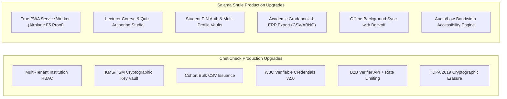

# Production Transformation Plan: ChetiCheck & Salama Shule
**Author**: Master Orchestrator (incorporating Agents 08-Architect, 05-Backend, 03-Frontend, 26-Fintech/Security, and 27-Production-Auditor)  
**Target Systems**:
- **ChetiCheck**: Enterprise Multi-Tenant Verifiable Credentials Platform
- **Salama Shule**: Resilient Offline-First LMS with True PWA & ERP Integration

---

## 1. Goal Description
Transform both applications from 48-hour hackathon prototypes into production-grade systems ready for live deployment across Kenyan universities (Riara, Strathmore, UoN, MKU) and corporate verifiers (HR agencies, recruiters, banks):



---

## 2. User Review Required

> [!IMPORTANT]
> **Architectural Milestones & Rollout Sequence**:
> Because upgrading both full-stack applications entails database schema migrations, service worker registrations, and new API routes, we propose executing in **3 structured implementation milestones**:
> - **Milestone 1 (ChetiCheck Enterprise Core)**: Multi-tenancy, RBAC auth, KMS key-vault abstraction, W3C credential schema, and bulk cohort CSV issuance.
> - **Milestone 2 (Salama Shule Resilient PWA & Studio)**: True Service Worker (`sw.js`) with Cache API, dynamic course/quiz authoring studio, student PIN security, and Kenyan ERP gradebook export.
> - **Milestone 3 (Verification & Hardening)**: Full integration tests, security audit, zero-emoji verification, mobile responsiveness, and clean git tags.

> [!WARNING]
> **Database Migration Policy**:
> We will preserve the existing SQLite/in-memory fallback modes so local offline development and preview environments continue to function without requiring active cloud Postgres credentials, while adding the full enterprise PostgreSQL schema definitions in Kysely.

---

## 3. Open Questions for Marcus
1. **Issuer Key Storage**: For the production key vault abstraction, do you prefer environment-injected encrypted PKCS#8 keys with KMS envelope encryption, or a mock AWS CloudHSM / HashiCorp Vault driver? (We propose an envelope-encrypted KeyProvider with mock KMS for local testing).
2. **ERP Format for Gradebook**: We plan to support standard CSV plus CampusDynamics/ABNO column mapping for Kenyan universities. Are there specific LMS export headers you want prioritized?

---

## 4. Proposed Changes: ChetiCheck (Enterprise Credential Platform)

### A. Multi-Tenant Institution Architecture & Kysely Schema
Extend database schema in [`cheti-check/helpers/schema.tsx`](file:///c:/Users/user%20pc/Desktop/2026/RIARA%20HACKATHON/cheti-check/helpers/schema.tsx):
- `institutions`: `id`, `name`, `slug`, `domain`, `status`, `publicKeyPem`, `keyId`, `contactEmail`, `createdAt`.
- `institutionUsers`: `id`, `institutionId`, `email`, `passwordHash`, `role` (`ADMIN`, `REGISTRAR`, `AUDITOR`), `createdAt`.
- `credentials`: Add `institutionId`, `keyId`, `w3cPayload` (JSON-LD), `salt` (for KDPA erasure), `studentIdHash`.
- `apiKeys`: `id`, `institutionId`, `keyHash`, `tier`, `rateLimit`, `createdAt`.

### B. Cryptographic Key Vault Abstraction (`helpers/keyVault.ts`)
Decouple raw database storage from key operations:
```typescript
export interface KeyVaultProvider {
  getSigningKey(keyId: string): Promise<CryptoKey | string>;
  getPublicKeyPem(keyId: string): Promise<string>;
  signPayload(keyId: string, payload: Buffer): Promise<string>;
  verifySignature(publicKeyPem: string, payload: Buffer, signature: string): Promise<boolean>;
}
```

### C. Cohort Bulk CSV Issuance (`endpoints/credentials/batch_issue_POST.ts` & UI)
- Lecturer/Registrar uploads CSV with columns: `studentName, admissionNumber, programme, award, graduationYear`.
- Server validates each record with Zod, signs in an atomic database transaction, and returns a download link for a batch cryptographic manifest and printable QR sheets.

### D. B2B Commercial Verifier API (`endpoints/api/v1/verify_POST.ts`)
- REST endpoint for HR agencies (e.g. BrighterMonday, Shortlist, corporate banks).
- Authenticated via `Authorization: Bearer cc_live_...`.
- Returns machine-readable W3C Verifiable Credential status with sub-50ms latency.

---

## 5. Proposed Changes: Salama Shule (Resilient PWA & Studio)

### A. True Progressive Web App (PWA) Engine
- **Service Worker (`public/sw.js`)**:
  - Precache core app shell (HTML, bundled JS, CSS, fonts, SVG icons).
  - Runtime cache for static unit content with stale-while-revalidate strategy.
  - Background Sync registration (`sync-attempts`) to retry submissions automatically on reconnection.
- **Web App Manifest (`public/manifest.webmanifest`)**:
  - Installable to home screen on Android and iOS.
  - Standalone display with university theme branding.
- **Verified Offline Test**: Survives hard page reload (<kbd>F5</kbd>) in real Airplane Mode.

### B. Lecturer Course & Quiz Authoring Studio (`pages/studio.tsx`)
- Intuitive, low-bandwidth unit builder:
  - Add/edit course modules, chapters, and markdown lesson text.
  - Author quiz questions, option lists, and explainable answer keys.
  - Generates synchronized unit content JSON served to students.

### C. Shared-Device Student PIN Security & Profile Vaults
- Multi-student profile support in `helpers/deviceStore.tsx`:
  - 4-digit student PIN locks local storage against unauthorized access.
  - Multiple students can use the same phone without leaking continuous assessment scores.

### D. Kenyan Academic Gradebook & ERP Export (`pages/lecturer.tsx` upgrade)
- Complete gradebook table with sortable columns, completion badges, and sync timestamps.
- **1-Click Export**:
  - Standard CSV
  - Kenyan CampusDynamics / ABNO format (Admission Number, Unit Code, Continuous Assessment Mark, Sync Timestamp).

---

## 6. Verification Plan

### Automated Testing
```bash
# Typecheck across both repos
cd cheti-check && npm run typecheck
cd ../salama-shule && npm run typecheck

# Full production build verification
cd cheti-check && npm run build
cd ../salama-shule && npm run build

# Zero emoji audit
node -e "/* verify zero emoji in source files */"
```

### Manual & Adversarial Verification
1. **ChetiCheck**:
   - Issue a 5-student cohort via CSV import; verify all 5 generate valid Ed25519 signatures.
   - Query B2B API with valid API key; verify response payload and rate-limit headers.
2. **Salama Shule**:
   - Enable Airplane Mode in Chrome DevTools Network tab.
   - Hit hard refresh (<kbd>F5</kbd>) -> Verify Service Worker serves cached app without network.
   - Complete quiz offline -> Re-enable network -> Verify automatic background sync.
   - Export lecturer gradebook -> Inspect CSV format compatibility.
